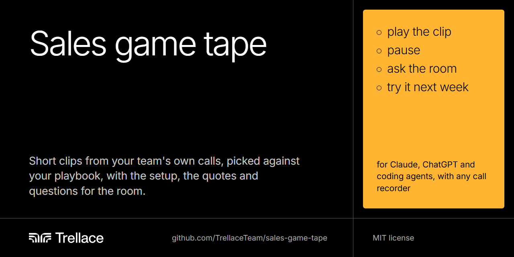

  

# Game tape for your sales team

This agent skill writes the game-tape part of your next sales meeting. Point it at your call recorder and your sales playbook. For each rep, it picks one clip of a playbook step done well and one clip to pause on, where the room says what they'd do next. Every clip comes with its link and start time, a one-line setup, the exact quotes and questions for the room. Sports teams call this game tape: watching your own plays to get better.

It runs in Claude, ChatGPT and coding agents, and it reads calls from Fathom, Fireflies, Gong, Grain, Avoma, Otter, Read AI, tl;dv, Zoom, Google Meet, Microsoft Teams or any transcript file. <!-- prose-allow: semicolon -->

## Start in five minutes

1. **Install it where you already work.**

   | You use | Do this |
   |---|---|
   | Claude, on the web or the desktop app | [Download game-tape.zip](https://github.com/TrellaceTeam/sales-game-tape/releases/latest/download/game-tape.zip). In Claude, open Customize, then Skills. Click +, then Create skill, then Upload a skill, and pick the zip. Code execution must be on, under Settings, Capabilities. On a Team or Enterprise plan, an owner may need to allow skills first |
   | ChatGPT Business, Enterprise or Edu | Download the same zip. Open Plugins, then the Skills tab, choose Create, then Upload from your computer. We haven't tested this route yet |
   | Gemini | Unzip it and upload the `game-tape` folder under Customize, Skills. Use exported transcripts. We haven't tested this route yet |
   | Claude Code, Codex, Cursor, OpenCode or GitHub Copilot | Run `npx skills add TrellaceTeam/sales-game-tape -g` to install it for every project. It needs Node.js 22.20 or later |
   | ChatGPT Plus or Pro, or anything else | Use [the paste-in prompt](prompts/game-tape.md) with exported transcripts |

2. **Connect your call recorder.** In Claude, open Customize, then Connectors, find your recorder and click Connect. In ChatGPT, find it under Plugins. Start a new chat after you connect. In Claude and ChatGPT, the skill uses the connector to find and pick calls, then asks you to download those few transcripts, with timestamps on, and upload them, so it can check every quote. In a coding agent, it reads them straight from the connector. The [recorder table](#connect-your-recorder) below says what works for yours.
3. **Ask for it.** Type "Prep game tape for Monday's sales meeting."
4. **Answer four questions.** Where your calls are, where your playbook is, who's on tape, and how long game tape runs. It may also check which people on your recorder are reps. It saves your answers as a team profile. In Claude or ChatGPT it hands you the profile as a file, so add it to a project, and next week starts with one question.
5. **Run the meeting.** Use the run sheet it writes.

## What you get

A run sheet in Markdown, ready to paste into your meeting agenda. Here's the last of four clips from [the example](examples/fennick/README.md), a full run on five calls from Fennick Software, a fictional company. It's a pause clip from the CEO's own call, right after a clip where she got the same step right.

> ### 4. Priya, pause: Sable Point Packaging (Oct 13, first call)
>
> **Why this step matters.** Same step, one week later. A buyer who says "I need to run it by my boss" is handing you the decision maker. The next question decides whether the boss ever meets you.
>
> **Set it up.** Greg is the maintenance manager at Sable Point, a 250-person corrugated box plant. He took the call because of three corrugator stops in August. Priya has just finished a full demo, and Greg has said the price is reasonable. <!-- prose-allow: just -->
>
> **Play part 1: [15:30 to 15:43](https://recorder.example/share/q5Ws1Sable1013?t=930).** Pause right after Greg says "[00:15:43] I like it. I really do. I'll need to run it by my boss. He'll want to see numbers." <!-- prose-allow: really -->
>
> **Ask the room while it's paused.**
> 1. What would you say next?
> 2. What do you want to know about the boss before you hang up?
>
> **What came before.** The answer key:
> - 9:31. "[00:09:31] Sorry, one thing before you move on. I've got budget left this year if we move before December."
> - 12:02. "[00:12:02] Does that break it out by machine? My plant manager, Neil Ostrowski, keeps asking me why the corrugator keeps going down."
> - 12:28. "[00:12:28] That'd be nice. Something to show him besides my spreadsheet. He's not a spreadsheet guy."
> - 17:06. "[00:17:06] We run hard until about the twentieth of December, and then we shut down for a week and do all the big jobs."
>
> Greg named his boss, what Neil asks about, and a budget deadline. A good next move: "What will Neil want to see? Could he join a 30-minute call next week so we can show him the downtime view?"
>
> **Play part 2: [15:43 to 16:33](https://recorder.example/share/q5Ws1Sable1013?t=943).**
>
> **What's good.**
> - Hears the concern kindly: "[00:15:54] Totally, that makes sense."
> - Promises the materials fast: "[00:16:10] I'll send our overview deck, a one-pager on pricing, and a recording of a demo like this one, so you can show it around."
>
> **The near-miss.** The call ended on "send some things and let me know". Priya said "[00:15:54] Why don't I send over a few things and you can take a look and let me know?" and Greg answered "[00:16:33] Perfect. Yeah, I'll get back to you next week or so." Nothing was booked and Neil was never asked about. Priya could have said:
> - "What will Neil want to see? Could he join us for 30 minutes next week? I have two times."
>
> **Ask the room.**
> 1. Compare this ending with Harrow Creek's. What changed?
> 2. Greg said he had budget left before December. How would you use that to book the next meeting?

A script that ships with the skill checks every quote against its transcript line, and every link against its start time. When a quote is wrong, the script prints the right time or the real words, and the assistant fixes it.

## How it picks the clips

1. **It maps your playbook.** For each step, it notes the job the rep is trying to get done, the lines your playbook uses, and what it looks like when the job is almost done. No playbook? It uses a [built-in first-call playbook](skills/game-tape/references/first-call-playbook.md).
2. **It shortlists recent calls.** It keeps first calls with outside buyers, then reads them in full. A coding agent can read each rep's calls in parallel.
3. **It finds two kinds of moments.** A good clip shows one step done well. A pause clip stops right after the buyer hands the rep an opening, such as naming the person who signs or a deadline, so the room can say what they'd do before hearing what happened.
4. **It reads around each pick.** That gives the setup, the answer key for a pause, and where the clip has to stop, such as before pricing talk.
5. **It checks every quote and link.** Then it hands you a recommended clip and two swaps for each slot.

## Run the meeting

The run sheet opens with a script. The format behind it:

1. **The person on the call speaks first.** Before anyone else weighs in, they say what they were going for.
2. **Play the good clip.** Ask what made it work, and where else it would help.
3. **Play the pause clip and stop at the pause.** Ask "what would you say next?" Then play on, and share what the buyer said earlier.
4. **Each person adds one thing that worked and one thing to try.** Keep it about the move, never the person.
5. **Pick one thing the whole team tries next week.** Tell the skill, and next week's tape looks for it.

## Connect your recorder

| Recorder | How the skill reads calls | Links open at the right second |
|---|---|---|
| Fathom | Connector or app. To upload a transcript, copy it into a text file | Yes. Check one link before the meeting |
| Fireflies, Grain, Otter, Read AI | Connector or app, or downloaded transcripts. Fireflies downloads need Pro | Fireflies from a copied link. Grain and Otter through their own clips |
| tl;dv <!-- prose-allow: semicolon --> | Connector on Pro, or copied transcripts | From a copied link |
| Gong | "Download transcript" on each call, or the API in a coding agent. Gong's connector returns summaries only | Yes, for viewers signed in to Gong |
| Avoma | Custom connector, or downloaded VTT | No. Use its public snippets |
| Zoom | Downloaded VTT. Needs Zoom Pro and "Create audio transcript" turned on | No. The run sheet says where to scrub |
| Google Meet | Drive connector or the transcript doc. Times only every 5 minutes | From Drive's "Copy link to this time" |
| Microsoft Teams | Downloaded VTT or DOCX. Organizers can download by default | No. The run sheet says where to scrub |
| Anything else | Upload transcripts as VTT, SRT, DOCX, JSON or TXT | From a copied link, when the recorder makes one |

For a recorder that doesn't document its links, the skill asks you once to copy a "link at this time" from your recorder, learns the pattern and saves it. [recorders.md](skills/game-tape/references/recorders.md) has the details for each recorder, written for the assistant.

## Make it yours

Ask for changes in plain words. The skill keeps the ones that should last in your team profile.

- "Use the last two weeks."
- "Match our playbook's exact lines, not only the purpose of each step."
- "One clip each, we only have 15 minutes."
- "Only my calls. I'm onboarding our first AE." It picks four to six good clips in call order, one per step.
- "Skip anything with pricing in it."

Your profile is a short Markdown file, `game-tape-profile.md`. It also lists the clips you've played, so next week's tape picks new moments. Edit it by hand any time.

## What's inside

| File | What it's for |
|---|---|
| [skills/game-tape/SKILL.md](skills/game-tape/SKILL.md) | The eight steps the assistant follows |
| [references/recorders.md](skills/game-tape/references/recorders.md) | How to get calls and links out of each recorder |
| [references/first-call-playbook.md](skills/game-tape/references/first-call-playbook.md) | The built-in playbook, ten steps with their jobs and near-misses |
| [references/run-sheet.md](skills/game-tape/references/run-sheet.md) | The run sheet's template and writing rules |
| [references/scan-brief.md](skills/game-tape/references/scan-brief.md) | The brief for reading one rep's calls |
| [references/profile.md](skills/game-tape/references/profile.md) | The team profile's template and every default |
| [scripts/tape.py](skills/game-tape/scripts/tape.py) | Converts transcript exports, learns link patterns and checks the run sheet. Python standard library only |
| [prompts/game-tape.md](prompts/game-tape.md) | The paste-in version for any chat assistant |
| [examples/fennick/](examples/fennick/README.md) | A full fictional run: five calls in five formats, the run sheet and the profile |

## What it touches

- **Reading only.** The skill tells the assistant to list and read calls and docs, and never to create, edit, share or delete anything in your recorder. Some recorder connectors can also share or delete, so to be sure, switch those tools off in the connector's settings.
- **Your files.** It writes a work folder for each run, `game-tape-<date>/`, and your team profile. The work folder holds transcripts with buyers' names, so keep it out of anything you share.
- **Keys.** It never asks for an API key in chat. In a coding agent, it reads a key from the file you name.
- **The room.** Buyers agreed to be recorded for the call, not to be shown widely. The skill skips sensitive moments, and the clips are for your team only.

## Where this comes from

We built it in October 2026 to prepare weekly game tape for a B2B sales team we work with, then rebuilt it so any founder can run it with the tools they already have. The way it picks clips, pauses before the moment that matters and keeps the room kind comes from those meetings.

## Limits

- Only Fathom and Gong document links that open at a second. Other recorders need a copied link, a clip made in the recorder, or a note on where to scrub. Zoom and Teams recording links can't open at a time we can build.
- Google Meet's transcript doc marks the time only every 5 minutes, so Meet clips land within about 5 minutes, and the leader finds the moment by its words.
- In Claude and ChatGPT, a connector's transcripts stay in the chat, out of reach of the checking script. So the skill uses the connector to pick calls and asks you to upload those calls' transcripts.
- A chat holds about 10 to 15 full calls. Coding agents with subagents read more.
- Transcripts mislabel speakers sometimes, and their times can sit a few seconds off the video. The run sheet starts each clip a few seconds early.
- It picks moments. You decide what plays. Watch every clip before the meeting.
- Vendors change menus and plans often. We checked every recorder's docs in October 2026. We've run the skill end to end in Claude Code. The Claude, ChatGPT and Gemini upload routes follow those apps' docs, and we haven't run them end to end yet.

## From Trellace

[Trellace](https://www.trellace.com/?utm_source=github&utm_medium=readme&utm_campaign=sales-game-tape) works with B2B founders in the messy middle, after product-market fit and before a repeatable go-to-market team. That's usually $1 million to $10 million in annual revenue. We publish the methods we use because GTM needs more open source projects.

- **Founders.** If something here is close to what you're working through, [book a 30-minute GTM Sparring Session](https://www.trellace.com/contact?utm_source=github&utm_medium=readme&utm_campaign=sales-game-tape).
- **Investors.** Most of our work starts with an introduction from a fund. If a company you back comes to mind, [make an introduction](https://www.trellace.com/contact?utm_source=github&utm_medium=readme&utm_campaign=sales-game-tape).
- **More free tools.** See everything we've published at [github.com/TrellaceTeam](https://github.com/TrellaceTeam).

## License

[MIT](LICENSE). Use it, change it and ship it, including for commercial work.
